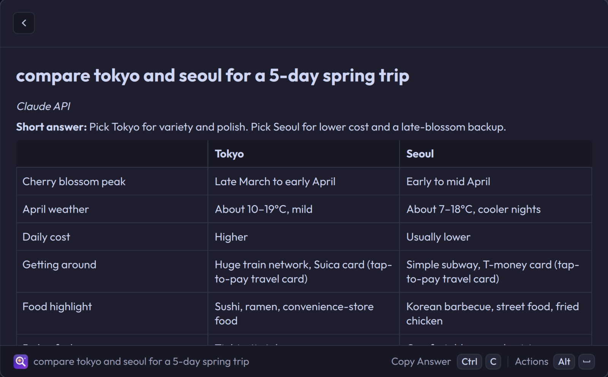

# Ask AI for Vicinae

Type a question into [Vicinae](https://vicinae.com). If nothing matches, press Enter and the answer streams in full-width. Press Esc to ask a follow-up. It's the Spotlight-to-Siri flow from macOS, for Linux; [docs/siri-reference.md](docs/siri-reference.md) documents that flow and what is left to copy.



## Commands

| Command | What it does |
|---|---|
| Ask AI | Ask a question; the answer fills the window. Works best as a fallback command. |
| Ask AI Histories | Past conversations on the left, the selected one in full on the right. Continue, copy or delete. |
| Ask AI Settings | Choose a provider first; only that provider's fields are shown. Also the answer style. |

## Providers

| Provider | Sign-in |
|---|---|
| Claude Code | Your existing `claude` login |
| Codex | Your existing `codex` login |
| Antigravity | Your existing `agy` login |
| Claude API | Anthropic API key, or any Anthropic-compatible gateway (set **Base URL**; the key is sent as a bearer token) |
| OpenAI API | OpenAI API key, or any gateway serving the Responses API (set **Base URL**) |
| Gemini API | Gemini API key |

The three login providers run the official command-line tool you already have installed and signed in to. The extension never reads their credentials, and each question runs in its own new, empty folder that is deleted afterwards. What the model can still do differs:

| Provider | Tools left to the model |
|---|---|
| Claude Code | None: `--tools ""`, no MCP servers, no settings or hooks loaded. |
| Codex | None: web search, the shell, browser, computer-use, image, sub-agent and other tool features are disabled, MCP servers are switched off, and the sandbox is read-only. |
| Antigravity | Its built-in tools stay loaded; Antigravity has no switch to remove them. Terminal commands run sandboxed (`--sandbox`), and anything that needs a permission prompt, such as reading your files, is refused because the run is headless. Rules you have pre-approved in your own Antigravity settings still apply. |

**Antigravity warning:** Google has suspended accounts for using third-party software with an Antigravity login. The reported cases extracted OAuth tokens, which this extension doesn't do, but the risk is yours. It is never the default.

## Answer style

**Output Style** is Full, Layman's terms (short sentences, everyday words, terms explained), or Custom (your own instructions).

**Rich Answers** is in the spirit of ChatGPT's Intelligent UI: the model may add an [OpenUI Lang](https://github.com/thesysdev/openui) block. It renders as headings, tables, bar charts, tips, code and map links, and its buttons and suggested follow-ups appear in the action menu. Ask for a calculator, converter or estimate and you get a live tool: Ctrl+O opens it as a form whose results update as you change the inputs. Turn Rich Answers off in settings for plain Markdown.

## Install

From the Vicinae store, once published: open **Store**, search for **Ask AI**, install.

Prebuilt, from the latest GitHub release:

```sh
mkdir -p ~/.local/share/vicinae/extensions/ask-ai
curl -fsSL https://github.com/Nael-Nathanael/vicinae-ask-ai/releases/latest/download/ask-ai.tar.gz \
  | tar -xz -C ~/.local/share/vicinae/extensions/ask-ai
systemctl --user restart vicinae
```

From source:

```sh
git clone https://github.com/Nael-Nathanael/vicinae-ask-ai
cd vicinae-ask-ai
npm install
npm run build
```

Then, in Vicinae:

1. Open **Configure Fallback Commands**.
2. Search for **Ask AI**, press Enter to enable it, and keep it at the top of the list.
3. Open **Ask AI Settings** and pick a provider.

Ask AI only takes over Enter when nothing else in the root search matches. A long question can fuzzy-match an app; check that Ask AI is selected before pressing Enter.

## Use

In the answer view:

| Shortcut | Action |
|---|---|
| Enter or Ctrl+C | Copy the answer |
| Esc or Ctrl+L | Ask a follow-up |
| Ctrl+Shift+C | Copy the conversation |
| Ctrl+Shift+K | Copy the last code block |
| Ctrl+. | Stop the answer |
| Ctrl+R | Ask again |
| Ctrl+N | New conversation |
| Ctrl+, | Settings |

Every follow-up includes the earlier turns. Launching Ask AI from the fallback always starts a new conversation. Opening it by name continues the last conversation if it was active in the past 10 minutes. The 100 most recent conversations are kept.

## Troubleshooting

- **"Couldn't find `claude`" (or `codex`, `agy`).** Vicinae runs as a systemd user service whose PATH often lacks your shell's additions. The extension also checks `~/.local/bin`. If your CLI lives elsewhere, add its folder under **Extra PATH** in settings.
- **Signed out.** Run `claude auth login`, `codex login`, or `agy` in a terminal.
- **New commands don't appear after `npm run build`.** Run `npm run dev` once; it makes Vicinae reload the extension.

## Development

```sh
npm run dev        # hot reload into Vicinae
npm test           # unit tests
npm run typecheck
npm run lint       # manifest check
node --experimental-strip-types test/live.ts   # real calls; see the file header for keys
```

Built against Vicinae 0.21.1 and works on newer versions.

## License

MIT
