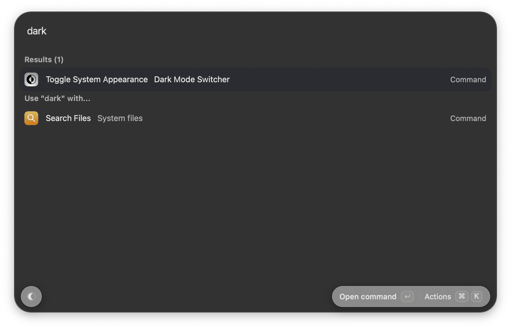

# Dark Mode Switcher for Vicinae

This extension recreates the **Toggle System Appearance** action from Raycast to toggle between dark and light system theme.



Works on macOS and on Linux desktops that follow the GNOME color scheme setting. macOS may ask for permission to control system appearance. Windows is not supported.

## Install from source

```sh
npm install
npm run build
```
