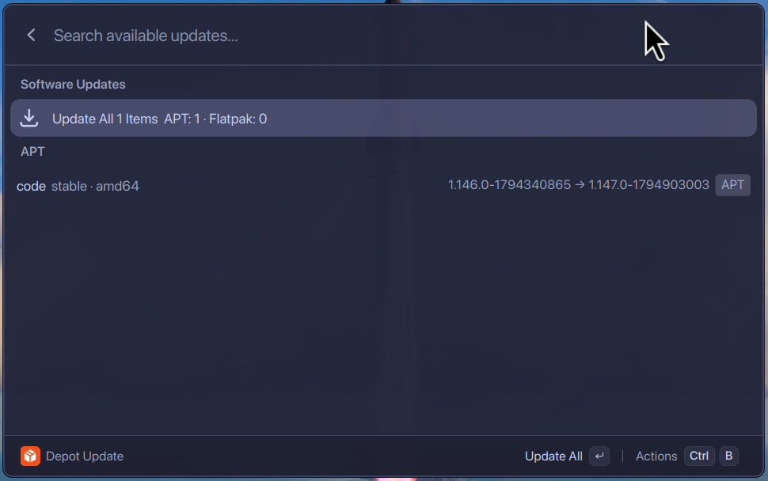

# Depot for Vicinae

Keep Linux software up to date and your system tidy without leaving the
launcher. Depot works with the APT sources and Flatpak remotes you already
have, through one keyboard-first workflow.

## Commands

**Depot Update** groups available APT and Flatpak updates by source and
applies one item, one source, or everything. Held packages and updates Ubuntu
is still phasing in are left alone.

**Depot Clean** previews unused packages, obsolete package archives, and unused
Flatpak runtimes, and removes them only after you confirm.

## Highlights

- Review before every change, with native system authentication
- APT and Flatpak handled independently, so one failing never blocks the other
- Recent Actions history, including details when something fails
- No background process: Depot only runs while a command is open

## Safety

Depot never adds repositories, signing keys, or scripts, and it never sees your
password. Cleanup is simulated first and blocked if it would remove anything
you did not review. Application settings and personal data are never touched.
See [SECURITY.md](SECURITY.md) for details.

## Requirements

- Vicinae 0.28.1 or later
- Ubuntu (Debian and Ubuntu-based distributions are best-effort)
- Optional: Flatpak with a configured remote

For the smoothest authentication prompts, set `close_on_focus_loss: false` in
Vicinae.

## Learn more

[Updates](docs/updates-and-removal.md) · [Cleanup](docs/cleanup.md) ·
[Contributing](CONTRIBUTING.md) · [Changelog](CHANGELOG.md)
