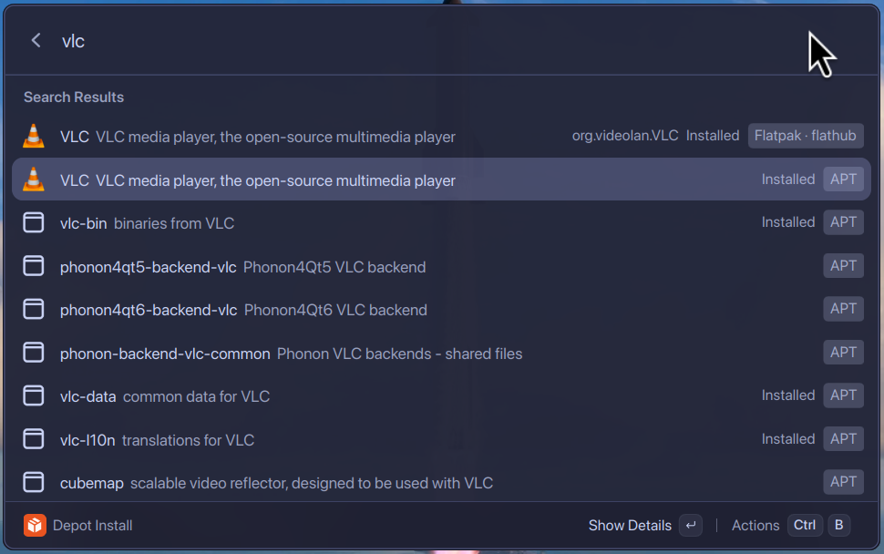
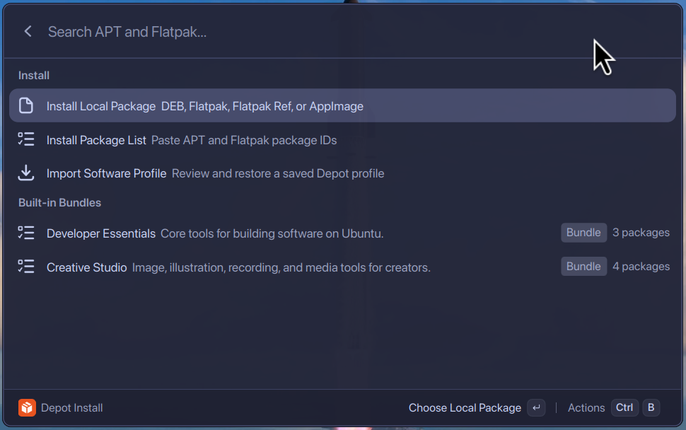
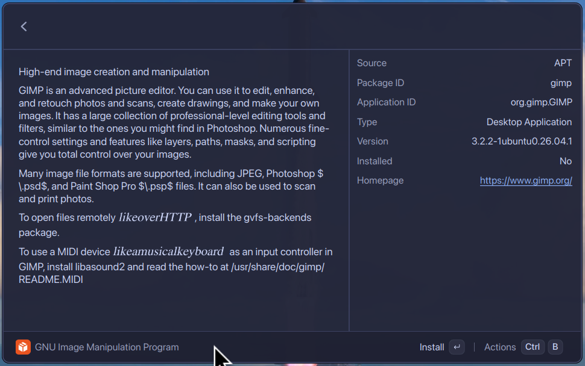
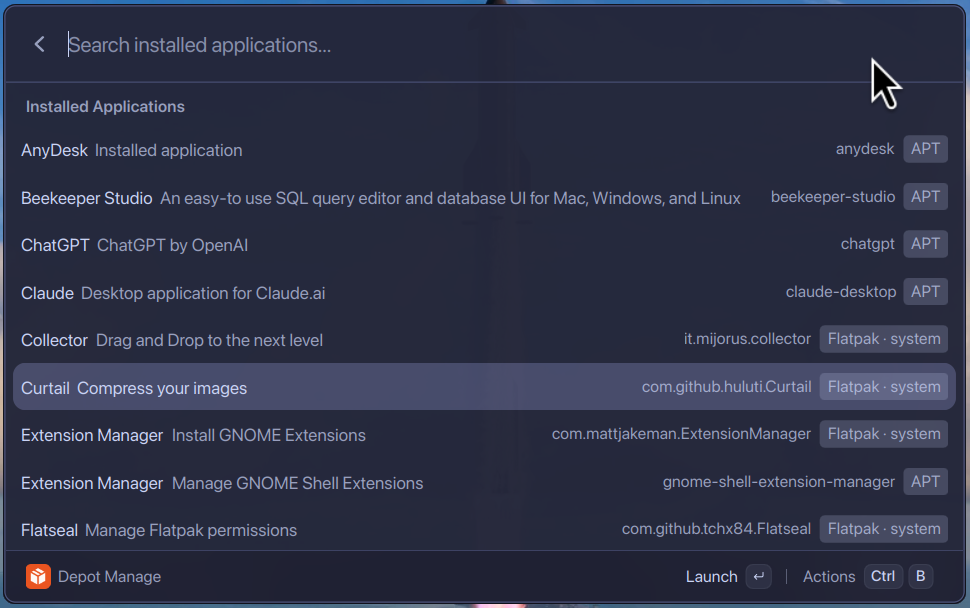
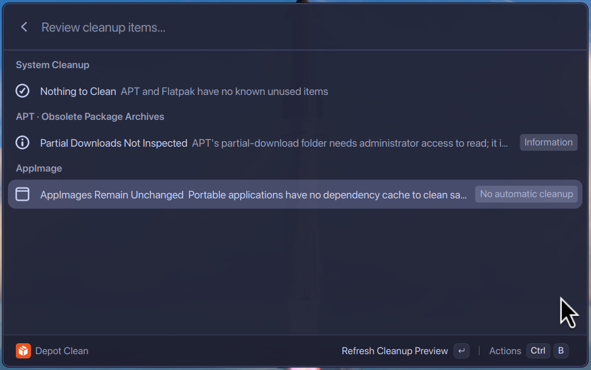

# Depot for Vicinae

Install, manage, update, and clean Linux software without leaving the
launcher. Depot brings APT, Flatpak, and AppImages together behind one
keyboard-first workflow:

**Super + Space → search → act → done**

## Commands

**Depot Install** searches your APT repositories and Flatpak remotes in one
ranked list. Before you type, it offers local packages, package lists,
built-in bundles, and profile import.

Every result shows its source, version, and details before you act.

**Depot Manage** launches, inspects, removes, and exports everything you have
installed, from APT, Flatpak, and `~/Applications` AppImages alike.

**Depot Update** groups available updates by source and applies one item, one
source, or everything.

**Depot Clean** previews unused packages, obsolete archives, and unused
Flatpak runtimes, and removes them only after you confirm.

## Highlights

- One search across APT and Flatpak, with a **Preferred Source** setting that
  ranks your choice first without hiding alternatives
- Local `.deb`, `.flatpak`, `.flatpakref`, and AppImage files, inspected before
  installation
- Developer Essentials and Creative Studio bundles, pasteable package lists,
  and portable software profiles
- Review-first removals, updates, and cleanup, with native system
  authentication
- Recent Actions history, including details when something fails
- No background process: Depot only runs while a command is open

## Safety

Depot uses the APT sources and Flatpak remotes you already have. It never adds
repositories, signing keys, or scripts, and it never sees your password.
Removals and cleanup are simulated first and blocked if they would remove
anything you did not review. Application settings and personal data are never
touched. See [SECURITY.md](SECURITY.md) for details.

## Requirements

- Vicinae 0.28.1 or later
- Ubuntu (Debian and Ubuntu-based distributions are best-effort)
- Optional: Flatpak with a configured remote, and AppStream metadata for richer
  names, icons, and ranking

For the smoothest authentication prompts, set `close_on_focus_loss: false` in
Vicinae.

## Learn more

[Bundles](docs/bundles.md) · [Profiles](docs/profiles.md) ·
[Updates and removal](docs/updates-and-removal.md) ·
[Cleanup](docs/cleanup.md) · [Contributing](CONTRIBUTING.md) ·
[Changelog](CHANGELOG.md)
