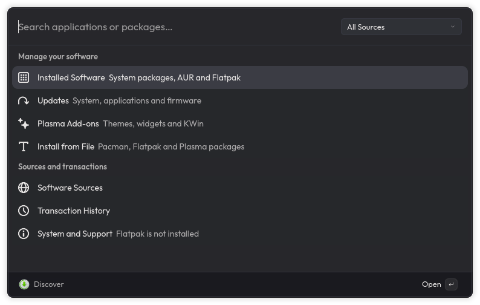

# Discover for Vicinae

A native Vicinae software center for CachyOS and Arch Linux. Search packages, manage installed software and review updates from one keyboard-driven interface.

[](https://github.com/rzgrozt/vicinae-discover/actions/workflows/ci.yml)
[](LICENSE)

Built with TypeScript, React and `@vicinae/api` **0.29.2**. The tested Vicinae baseline is **0.29.2** and all extension-owned interface text is in English. This is an independent extension, not an official KDE Discover release.



## Commands

| Command             | Features                                                                                                          |
| ------------------- | ----------------------------------------------------------------------------------------------------------------- |
| Software Center     | Search repository packages, AUR and configured Flatpak remotes; package details; installation and removal         |
| Installed Software  | System packages, foreign/local packages, Flatpak applications and firmware devices                                |
| Updates             | Full system upgrade, AUR upgrades, Flatpak app/runtime updates and device firmware                                |
| Software Sources    | Pacman repository and mirror priority, Flatpak remote management, firmware remote enable/disable                  |
| Plasma Add-ons      | Installed Plasma/KWin packages, remove user packages, open all installed KNewStuff stores                         |
| Install from File   | `.pkg.tar.zst` and other supported pacman archives, `.flatpak`, `.flatpakref`, `.flatpakrepo` and Plasma packages |
| Transaction History | Persistent transaction status and live output, including failures                                                 |
| System and Support  | Detected tools, optional dependency installation and a support report                                             |

## Install and develop

```sh
git clone https://github.com/rzgrozt/vicinae-discover.git
cd vicinae-discover
npm ci
npm run check
npm run build
```

`npm run build` installs the compiled extension into Vicinae's per-user extension directory. Search for **Software Center** or **Discover** in Vicinae. No server restart is needed. `npm run dev` starts development mode. To build a standalone bundle without installing it, run:

```sh
npm run build:bundle
```

Node.js **22+** and Python 3 are required. Use the Vicinae SDK's `vici` executable supplied by `@vicinae/api`; the unrelated npm package named `vici` is not needed.

### Optional integrations

| Feature                   | System tools                                                          |
| ------------------------- | --------------------------------------------------------------------- |
| Repository packages       | `pacman`, `pacman-conf`, `pkexec` and a running desktop Polkit agent  |
| Fresh update checks       | `checkupdates` from `pacman-contrib`                                  |
| AUR builds                | `paru` or `yay`, plus a default terminal configured in Vicinae        |
| Flatpak                   | `flatpak` and configured remotes                                      |
| Firmware                  | `fwupdmgr` from `fwupd`                                               |
| Plasma add-ons            | `knewstuff-dialog6`, `kpackagetool6` and installed KNS configurations |
| Rich application metadata | System Python with PyGObject and AppStream introspection              |

Missing tools appear in **System and Support**. They are installed only when you explicitly start an installation from that view. The extension does not add Flathub or other repositories automatically.

## System integration

- **CachyOS/Arch:** uses pacman and `pacman-conf`, preserving repository order and optimized CachyOS packages. Installs perform `pacman -Syu --needed` with an exact repository/package target. System upgrades refresh repositories and upgrade the whole system together; the extension never runs a standalone `pacman -Sy` against the system database.
- **Removal:** removes only the selected package. It never uses cascade, dependency bypass or recursive orphan removal. Pacman refuses removal when a required dependency would be broken.
- **Fresh update checks:** `checkupdates` from `pacman-contrib` checks new metadata in its separate database. The initial list uses the current local sync database. Choose **Check for Updates** for a fresh check.
- **AUR:** RPC searches and package details; `paru` or `yay` runs as the normal user in a terminal for PKGBUILD review and build choices. Terminal launching uses Vicinae's `runInTerminal` API and honors the user's default terminal. A foreign package is shown as **AUR / local package** because foreign packages are not necessarily from AUR.
- **Flatpak:** user and default system installations are kept distinct. Full references retain the application/runtime kind, ID, architecture and branch. Updates include runtimes; removing an application preserves its data. Source addition requires an HTTPS `.flatpakrepo` URL and retains Flatpak's signature checks.
- **Firmware:** uses fwupd JSON output, preserves device-specific update identity and flags, and does not automatically reboot or send firmware history reports.
- **Plasma:** uses the installed KNewStuff configurations and KDE's store dialog for correct downloads, dependencies and installation. Installed KPackage metadata is browsed inside Vicinae. User packages can be removed; system add-ons remain owned by the system package manager.
- **AppStream:** optional system Python/PyGObject and AppStream provide descriptions and screenshots. Package-manager metadata remains available when these are absent.

System package changes use **Polkit**, with only `/usr/bin/pacman` elevated. The extension and transaction runner stay unprivileged. A transaction preview appears before starting. Pacman runs noninteractively after confirmation. Its preview uses cached repository metadata, so a full refresh may change the final package list, dependencies or replacements; the confirmation explicitly states this. AUR transactions retain the helper's interactive prompts.

Commands use argument arrays without shell interpolation. Detached Python runners preserve logs when you close Vicinae, and an exclusive transaction lock prevents overlapping extension transactions. Package managers also enforce their own system locks. Do not terminate a package manager to dismiss a progress view; closing the Vicinae window leaves the operation running.

## Host verification

The extension was developed against CachyOS and Vicinae 0.29.2. Available host integrations were pacman, `checkupdates`, AUR helpers, fwupd, KNewStuff and KPackage. Flatpak, PackageKit and KDE Discover were not installed.

```sh
npm run check   # TypeScript + isolated tests; no package changes
npm run smoke   # Read-only queries against this CachyOS host
```

GitHub Actions checks formatting, the extension manifest, TypeScript, tests, Python syntax and bundle builds on Node.js 22 and 24. The host-specific smoke test is intentionally excluded from CI.

Tests cover repository priority, epoch versions, invalid targets, argument injection, Flatpak scope/ref identity, runtime updates, backend failures, durable job output and overlapping transaction rejection. The host smoke test checks real search results, package details, AppStream enrichment, installed packages, updates, sources and Plasma metadata. It only constructs transaction previews; it does not execute package changes.

## Boundaries

This version is not a complete reimplementation of every KDE Discover feature. It does not implement review/rating submission, offline OS upgrades, Snap, APT, DNF, rpm-ostree or PackageKit. Additional named system Flatpak installations are not enumerated. AUR builds and pacman configuration editing use a terminal; KNewStuff stores use KDE's own window. These boundaries are also disclosed in **System and Support**.

Flatpak operations are implemented and tested with CLI fixtures but have not been exercised against an installed Flatpak runtime on this host. No privileged installation, removal, system upgrade or firmware write was executed during development; those paths still need an end-to-end check using a disposable VM or a user-selected real transaction. Successful type checking, builds and read-only checks do not by themselves establish full transaction compatibility.

Transaction data is kept in Vicinae's extension support directory. Uninstall from Vicinae's extension manager. Source code is MIT licensed.

## Contributing and store status

See [CONTRIBUTING.md](CONTRIBUTING.md) for development and transaction-testing guidance. Report bugs through [GitHub Issues](https://github.com/rzgrozt/vicinae-discover/issues).

Store publication is handled by the maintainers of [`vicinaehq/extensions`](https://github.com/vicinaehq/extensions). A submission must be reviewed and merged before it appears in the Vicinae store. Until then, install from source using the steps above.

## References

- [Vicinae extension API](https://docs.vicinae.com/extensions/introduction)
- [Vicinae extension installation](https://docs.vicinae.com/install-extensions)
- [Pacman manual](https://man.archlinux.org/man/pacman.8.en)
- [Flatpak command reference](https://docs.flatpak.org/en/latest/flatpak-command-reference.html)
- [fwupdmgr manual](https://fwupd.github.io/libfwupdplugin/fwupdmgr.html)
- [KDE Discover](https://github.com/KDE/discover)
