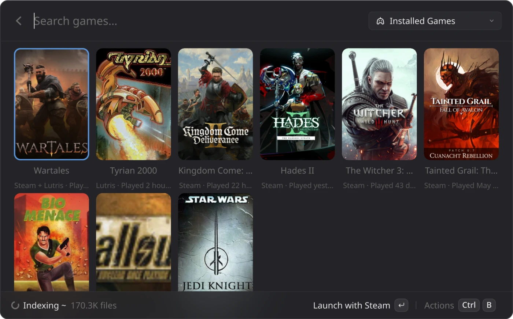
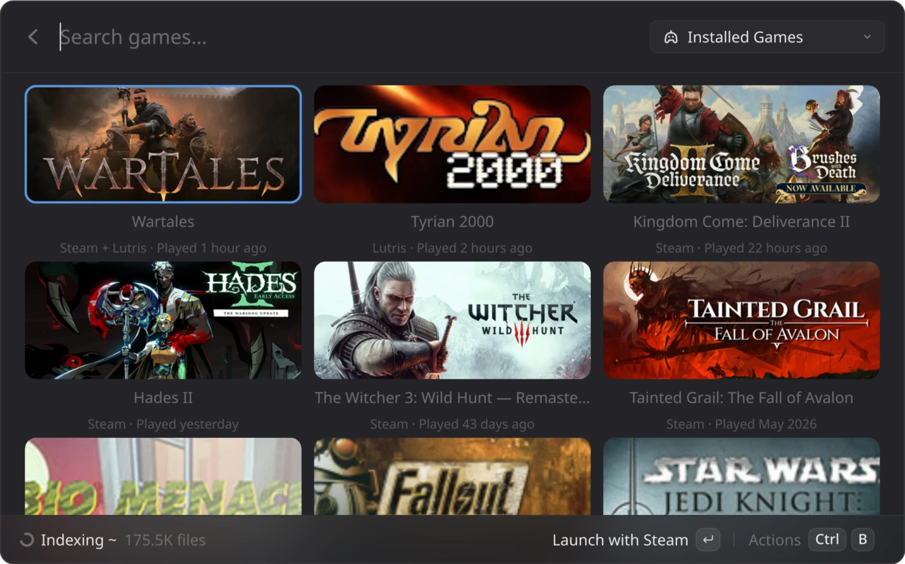
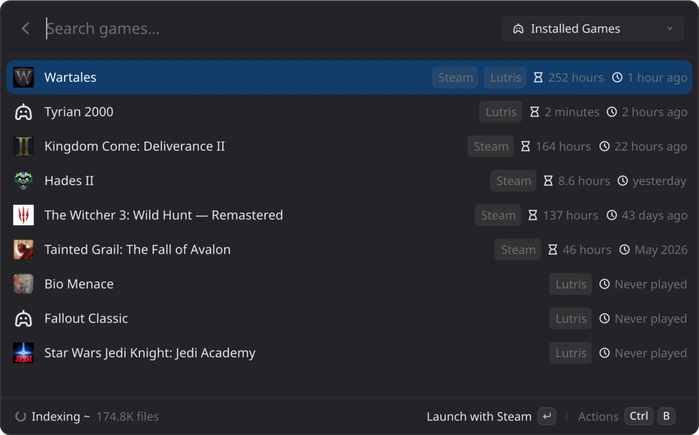

# Game Launcher for Vicinae

Search and launch your installed Linux games from [Vicinae](https://vicinae.com), in the spirit of Flow Launcher's
GamesLauncher plugin. Type a few letters, press Enter, play.

Supported launchers:

- **Steam**: native, Flatpak or Snap.
- **Lutris**: native or Flatpak. Covers games Lutris manages from GOG, Epic, Ubisoft and other stores, plus games you
  added by hand.
- **Heroic**: native or Flatpak. Covers Epic, GOG, Amazon and ZOOM games, plus apps you added to Heroic yourself.

Everything is read from the launchers' own files on disk. Nothing is sent anywhere except optional artwork downloads
(see [Privacy](#privacy-and-files)).

## Features

- **One searchable list** of installed games from every enabled launcher, most recently played first, as an
  artwork grid or a list.
- **Fast matching** on titles, acronyms (the initials of a long title), Steam App IDs and Lutris slugs.
- **One entry per game across launchers.** A game installed through several launchers (e.g. Steam and Lutris, or
  Lutris and Heroic) shows up once. Enter opens it with your preferred launcher, and "Launch with …" actions open it
  with the others.
- **Your launchers' organisation, reused**: Steam's Favorites, Hidden and manual collections, Lutris's favorite,
  hidden and other categories, and Heroic's favourites, hidden list and custom categories appear in the filter
  dropdown and are respected when hiding.
- **Sharp artwork on HiDPI screens**: optional high-resolution covers, banners and icons for Steam and Heroic games,
  cached on disk. Custom artwork you set in Steam always wins.
- **Tools and store clients filtered out**: Proton, the Steam Linux Runtime and redistributables don't clutter the
  list, nor do the store clients Lutris installs to run your games (Epic Games Store, EA app, Ubisoft Connect,
  Battle.net, Origin, Steam). Both can be shown in Settings.
- **No manual refresh needed**: the library is rescanned every time the command opens, which takes milliseconds.

## Screenshots

**Banner grid**: wide store artwork, several games per row.

**List**: launcher tags, playtime and last played for each game.

## Requirements

- [Vicinae](https://vicinae.com) 0.30 or newer.
- Node.js 22.16 or newer, the runtime Vicinae runs extensions with. Lutris support relies on Node's built-in
  `node:sqlite`; with Lutris turned off, Node 22.2 or newer is enough.

## Usage

Open **Search Games**, type to filter, and press **Enter** to launch the selected game. If the launcher isn't
running yet (e.g. Steam), it starts first and then launches the game. You can give the command an alias such as `gl`
(Flow Launcher's keyword) or a hotkey in Vicinae's settings, under Extensions › Game Launcher.

### Actions and shortcuts

| Action | Shortcut | Notes |
| --- | --- | --- |
| Launch Game | Enter | "Launch with Steam" when the game is installed in several launchers. |
| Launch with *other launcher* | Ctrl+Enter | First alternate launcher; any further ones are in the action panel. |
| Show in Steam Library | Ctrl+L | Steam games. |
| Open Install Folder | Ctrl+O | |
| Open Store Page | Ctrl+S | Steam games, opens in the Steam client. |
| View on ProtonDB | Ctrl+P | Steam games, opens in your browser. |
| Copy App ID | Ctrl+Shift+C | Steam games. |
| Show / Hide Details | Ctrl+D | List layout only. |
| Hide Game / Unhide Game | Ctrl+H | See [Hiding games](#hiding-games). |
| Settings | Ctrl+, | |
| Launcher Priority… | | When more than one launcher is enabled. |
| Clear Artwork Cache… | | Asks for confirmation first. |

The action panel itself opens with Vicinae's usual shortcut (Ctrl+B).

### Filtering

The dropdown next to the search bar switches between:

- **Installed Games**: everything that isn't hidden.
- **Steam Games / Lutris Games / Heroic Games**: shown when games come from more than one launcher. A game installed
  in several counts for each.
- **Hidden Games**: games hidden here or in their launcher.
- **Collections**, grouped by launcher: Steam's Favorites and manual collections, Lutris's favorite and custom
  categories, and Heroic's favourites and custom categories. Only collections with at least one visible installed
  game are listed.

### Hiding games

A game is hidden if you hid it here **or** it's hidden in its own launcher (Steam's Hidden collection, Lutris's
hidden category, Heroic's hidden list). The extension never writes to a launcher's data, so:

- Unhiding a game the launcher hides shows it here only; the launcher keeps hiding it. The toast says so.
- Hiding it again here restores the launcher's choice.
- Hiding a merged game (one installed in several launchers, listed once) hides every copy, so it stays hidden whichever
  launcher is preferred, and if you later turn off Merge Duplicates. With Merge Duplicates off, each copy is listed
  separately and hiding one leaves the others shown.

Hidden games are listed under **Hidden Games** in the dropdown.

## Settings

Open them with **Ctrl+,** from any game, or from Vicinae's settings under Extensions › Game Launcher. They come in
two groups.

**Preferences** (which games are found):

| Setting | Default | What it does |
| --- | --- | --- |
| Steam | On | Show games installed through Steam. |
| Lutris | On | Show games installed through Lutris. |
| Heroic | On | Show games installed through Heroic. |
| Merge Duplicates | On | Show a game installed in several launchers as one entry (see [Multiple launchers](#multiple-launchers)). |
| Steam Folder | Auto | Use only the Steam install in this folder instead of auto-detecting. |
| Show Steam Tools | Off | Also list Proton, the Steam Linux Runtime and other non-game Steam apps. |
| Lutris Folder | Auto | Use only the Lutris data folder at this path (the one containing `pga.db`). |
| Show Lutris Store Clients | Off | Also list the store apps Lutris installs to run games, such as the Epic Games Store and Battle.net. |
| Heroic Folder | Auto | Use only the Heroic config folder at this path (the one containing `config.json`). |

**Commands › Search Games** (how games are shown):

| Setting | Default | What it does |
| --- | --- | --- |
| Layout | Grid | Grid, List, or List with Details. |
| Grid Artwork | Cover | Cover (portrait), Banner (store header), Hero (wide background) or Logo. |
| Games per Row | Auto | 2–8, or Auto, which suits the artwork: 5 covers, 3 banners, 2 heroes, 4 logos. |
| Grid Labels | Title and Last Played | Title and Last Played, Title Only, or None. |
| Download High-Quality Artwork | On | Download higher-resolution artwork where available (see [Artwork](#artwork)). |

If a folder setting doesn't point at a valid install, the extension says so: in the empty state when nothing was
found, or in a toast when other launchers still have games.

## Multiple launchers

- **Turning launchers on and off**: a launcher turned off in Settings isn't scanned at all. Its cached data and your
  hidden-game choices are kept for when you turn it back on.
- **Matching duplicates**: games are matched across launchers by store identity, e.g. a Steam game that Lutris
  manages through its Steam integration, a Steam-runner game added to Lutris by hand (its Steam App ID is read
  from the Lutris game config), or the same Epic or GOG game installed through both Lutris and Heroic. Copies within
  the *same* launcher are never merged.
- **Merged entries**: Enter uses your preferred launcher; the others become "Launch with …" actions. Last played and
  playtime take the most recent and largest value across copies (not the sum, which would double-count). Missing
  artwork is filled in from other copies, and Steam actions stay available even when Lutris is preferred. Turn off
  **Merge Duplicates** to list every copy separately.
- **Launcher Priority…** (in the action panel or the empty state) sets which launcher is preferred. Use Move Up /
  Move Down (Ctrl+Shift+↑ / ↓) or Reset to Default Order. The default is Steam, then Lutris, then Heroic.
  Changes apply immediately.
- **One install per launcher**: if you have, say, both native and Flatpak Lutris or Heroic, only the first one found is used
  (native, then Flatpak, then Snap for Steam), or the one the folder setting points at. The others are mentioned in
  the empty state and logs. Every library folder of the chosen Steam install is scanned, including ones on other
  drives.

## Artwork

- **Steam**: the extension uses Steam's local cache (`appcache/librarycache`). That cache only holds low-resolution
  art: 300×450 covers, 460×215 banners and 32px icons. With **Download High-Quality Artwork** on, it also downloads
  2× covers and banners from Steam's CDN, plus the largest image inside each game's client `.ico`, and caches them.
  Many games only publish a 32px icon; those keep it.
- **Custom artwork** you've set in Steam (e.g. from SteamGridDB, stored in `userdata/*/config/grid`) always wins and
  is never replaced by downloads.
- **Lutris**: covers, banners and icons come from Lutris's own folders. Lutris stores small images (264×352 covers,
  184×69 banners) and there is no higher-resolution source, so they can look soft next to Steam's.
- **Heroic**: the extension uses the icons and the small copies of store art Heroic keeps (its image cache only
  holds what Heroic's own UI has shown). With **Download High-Quality Artwork** on, it downloads the store artwork
  listed in Heroic's library instead (Epic art at a HiDPI-friendly size), and caches it.
- **Only what's on screen is downloaded**: covers for the cover grid, banners for the banner grid, heroes and logos
  for those grids, and icons and banners for the list layouts. Steam's hero and logo art is already full size
  locally, so only Heroic games download those.
- **Cache upkeep**: Steam art is refreshed after 30 days; Heroic art is downloaded again when the store's image URL
  changes. Missing art is retried after 7 days, and network errors on the next open. Art for uninstalled games is removed automatically, but not while a library folder
  is unreachable (e.g. an unplugged drive).
- **Clear Artwork Cache…** deletes everything downloaded. Launchers' own art and your custom art are not touched.

## Privacy and files

**Network access**: the only automatic network traffic is artwork downloads: from `cdn.cloudflare.steamstatic.com`
for Steam games (each request contains only a Steam App ID and an image name), and for Heroic games from the image
URLs in Heroic's library, which point at the stores' own CDNs (e.g. `cdn1.epicgames.com`, `images.gog-statics.com`).
Turn off **Download High-Quality Artwork** to disable it. "View on ProtonDB" opens your browser only when you choose it. No analytics, no accounts, no API keys.

**Files read**: the launchers' own data, read-only:

- Steam: manifests, `appinfo.vdf`, `localconfig.vdf`, and the local copy of its collections.
- Lutris: `pga.db`, opened read-only, plus its game configs and artwork folders.
- Heroic: its installed-games lists, library caches, play time and settings (JSON), plus its icon and image caches.
  Account files (logins, cookies) are never read.

**Files written**: under `~/.local/share/vicinae/support/game-launcher/`:

| Path | Contents |
| --- | --- |
| `artwork/` | Downloaded high-resolution artwork. |
| `appinfo-cache.json` | Each installed Steam app's type and icon IDs, so the large `appinfo.vdf` is only read for new games or re-checked monthly. |
| `launcher-priority.json` | Your launcher order. |

Your hidden games and "shown here" choices are kept in Vicinae's local storage for the extension. Settings live in
Vicinae's `~/.config/vicinae/settings.json`.

## Limitations

- Steam's **dynamic (rule-based) collections** aren't shown; Favorites and manual collections are.
- Hidden status and collections are **read-only**: hiding a game here doesn't hide it in its launcher.
- **One install per launcher**, as described above.
- Duplicate matching relies on **store identity**. Two unrelated entries for the same game with no store link (e.g. a
  manually added Lutris game pointing at a GOG installer) aren't merged.
- **Lutris artwork is low resolution**, as described above.
- Heroic's favourites and hidden list record a game's app ID but not its store, so an entry applies to that ID in
  every Heroic store (in practice, IDs don't clash across stores).

## How it works

### Steam

| Data | Source |
| --- | --- |
| Library folders | `steamapps/libraryfolders.vdf` |
| Installed games | `<library>/steamapps/appmanifest_*.acf`. A game is listed once fully installed, but games mid-update keep their cached data. |
| Game vs. tool | `appcache/appinfo.vdf` (binary, formats v27–v29), field `common.type`, remembered in `appinfo-cache.json`. Falls back to known IDs and names if the file is unreadable. |
| Last played, playtime | Each game's manifest and `userdata/*/config/localconfig.vdf`, merged across accounts |
| Favorites, Hidden, collections | `userdata/*/config/cloudstorage/cloud-storage-namespace-1.json` (`user-collections.*`) |
| Artwork | `appcache/librarycache/<appid>/…` (flat, per-app and hashed layouts), `userdata/*/config/grid`, CDN `library_600x900_2x.jpg` / `library_header_2x.jpg` / client `.ico` |
| Launch | `steam://rungameid/<appid>` |

### Lutris

| Data | Source |
| --- | --- |
| Games, last played, playtime | `pga.db` (SQLite, read-only), installed games only |
| Favorites, hidden, collections | Categories: `favorite`, `.hidden`, and any other non-hidden category |
| Duplicate matching | `service` + `service_id` (e.g. `gog:1207658901`), or `game.appid` from the game's YAML config for Steam-runner games |
| Artwork | `coverart/<slug>.jpg`, `banners/<slug>.jpg`, `~/.local/share/icons/hicolor/128x128/apps/lutris_<slug>.png` |
| Launch | `lutris:rungameid/<id>` |

### Heroic

Paths are relative to Heroic's config folder (`~/.config/heroic`, or `~/.var/app/com.heroicgameslauncher.hgl/config/heroic` for the Flatpak).

| Data | Source |
| --- | --- |
| Installed games | `legendaryConfig/legendary/installed.json` and `third-party-installed.json` (Epic), `gog_store/installed.json`, `nile_config/nile/installed.json` (Amazon), `zoom_store/installed.json`, `sideload_apps/library.json`. DLC is left out. |
| Titles, art URLs | `store_cache/<store>_library.json` |
| Last played, playtime | `store/timestamp.json` |
| Favourites, hidden, categories | `store/config.json` (`games.favourites`, `games.hidden`, `games.customCategories`) |
| Duplicate matching | The store and app ID, under Lutris's service names (e.g. `egs:<app name>`, `gog:<product id>`, `amazon:…`, `zoomplatform:…`) |
| Artwork | `icons/<app name>.jpg/.png`, `images-cache/<sha256 of the image URL>`, store art URLs from the library caches |
| Launch | `heroic://launch?appName=<app name>&runner=<store>` |

## AI disclosure

This extension was developed with AI assistance. Most of the code, tests and documentation were written by
Anthropic's Claude, using Claude Code, under the maintainer's direction. The maintainer made the design decisions,
reviewed the changes, and tested the extension on their own Linux system with Steam, Lutris and Heroic. The code was also
checked by AI code reviews, and issues found were fixed with regression tests. Please report anything that looks
wrong.

## Acknowledgements

Inspired by [GamesLauncher](https://github.com/KrystianLesniak/Flow.Launcher.Plugin.GamesLauncher) for Flow
Launcher. Not affiliated with Valve, Lutris, Heroic Games Launcher or Vicinae.

## License

[MIT](LICENSE)
