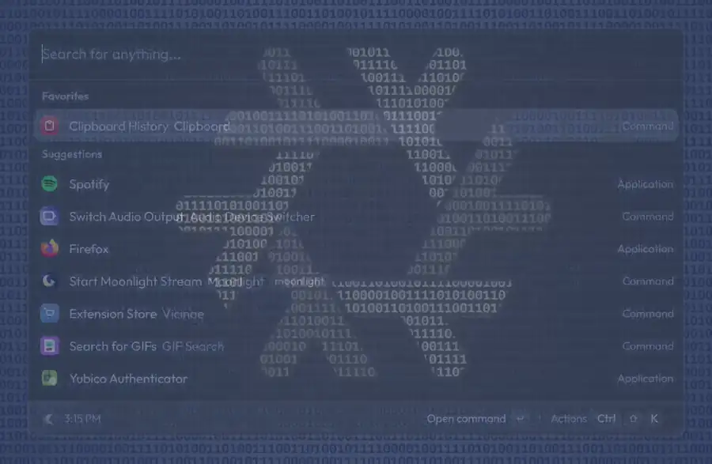

# Moonlight for Vicinae

Start, resume and end [Moonlight](https://moonlight-stream.org) game-streaming sessions from
[Vicinae](https://vicinae.com). Pick a host and an app, press Enter, and you're streaming.



## Why

Moonlight, the open-source client, and [Sunshine](https://github.com/LizardByte/Sunshine), the self-hosted
server, have become a popular way to stream not just games but whole desktops: from a gaming PC to the couch, from
a Mac mini to a Linux workstation, from a homelab box to a laptop. The usual flow still goes through Moonlight's own
window, though: open it, wait for host discovery, click the host, then click the app.

This extension cuts that down to one keystroke from your launcher. It also answers the questions the Moonlight window
doesn't show at a glance: *is something already running on that host, and is it this machine that's streaming it?*
That way you don't start a second session by accident, and you can end one cleanly without leaving the keyboard.

It doesn't replace Moonlight. It drives the `moonlight` command line you already have and reuses its pairing,
settings and box art.

## Features

- **Your paired hosts and their apps in one list**, with box art, grouped by host. The list opens instantly from a
  cache and refreshes in the background.
- **Session awareness per host.**
  - **Streaming on this PC:** green play icon. Enter tells you you're already connected, so there's no second session.
  - **Running on the host, not streamed here:** orange dot. Enter resumes it.
  - **Host busy with another app:** the other apps are shown muted. Enter explains why, and *Quit Running App &
    Start* switches apps on purpose.
- **End Session**, which ends a stream properly: it stops the local client, quits the app on the host and refreshes.
- **Hidden apps stay hidden**, because Moonlight's own *Hidden* flag is respected. A preference brings them back.
- **Optional stream overrides** for resolution, frame rate, bitrate, display mode and quit-after. By default your
  Moonlight settings are used unchanged.
- **Clear error states**: Moonlight not installed, no paired hosts, unreadable config, or host offline (with Retry).

## Requirements

- Linux, with [Vicinae](https://vicinae.com) 0.30 or newer.
- [Moonlight](https://moonlight-stream.org) (`moonlight-qt`) with the `moonlight` command on your `PATH`, or set
  its path in the preferences. Native and Flatpak installs both work.
- At least one host already **paired in Moonlight**: Sunshine, Apollo or NVIDIA GameStream. The extension never
  pairs, so do that once in the Moonlight window.
- Optional: `setsid` (util-linux, preinstalled on most distributions). With it, streams are started outside Vicinae's
  process tree; see [Under the hood](#under-the-hood).

## Usage

Open **Start Moonlight Stream**, type to filter, and press **Enter** on an app. You can give the command an alias
(e.g. `ml`) or a hotkey in Vicinae's settings, under Extensions › Moonlight.

### Actions

| Action | Shortcut | When |
|---|---|---|
| Start Stream | <kbd>Enter</kbd> | the host is free |
| Resume Stream | <kbd>Enter</kbd> | this app is running on the host but not streamed here |
| Already Streaming | <kbd>Enter</kbd> | this PC is already streaming it (only shows a hint) |
| Host Busy | <kbd>Enter</kbd> | another app is running on the host (only shows a hint) |
| Quit Running App & Start | action panel | another app is running and this PC isn't streaming it |
| End Session | Vicinae's *Remove* shortcut (<kbd>Ctrl</kbd>+<kbd>X</kbd> by default) | the host is busy or this PC is streaming it |
| Quit Running App on Host | <kbd>Ctrl</kbd>+<kbd>Q</kbd> | always |
| Copy Stream Command | Vicinae's *Copy* shortcut | to run or script the same stream from a terminal |
| Refresh | Vicinae's *Refresh* shortcut | re-reads apps and host status |

## Preferences

All preferences are optional. With the defaults, the extension behaves exactly like Moonlight itself.

| Preference | Default | What it does |
|---|---|---|
| **Moonlight Binary** | `moonlight` | Name (looked up on `PATH`) or absolute path of the `moonlight-qt` executable. A leading `~/` is expanded. |
| **Moonlight Config File** | *empty* (auto-detect) | Path to `Moonlight.conf`. If empty, it looks at the native location first, then the Flatpak one (see below). If set, only this file is used, and the error page names it if it can't be read. |
| **Host Status Timeout (seconds)** | *empty* (3 s) | How long to wait for a host's status. Decimals allowed, clamped to 0.5–30 s. Raise it for hosts behind a VPN or slow links. |
| **Hidden Apps** | off | Also list apps marked *Hidden* in Moonlight, shown with a muted eye icon. The app that's currently running is always listed. |
| **Resolution** | Moonlight default | `720p`, `1080p`, `1440p` or `4K`, passed to `moonlight stream`. |
| **Frame Rate** | *empty* (Moonlight default) | e.g. `60`. |
| **Bitrate (Kbps)** | *empty* (Moonlight default) | e.g. `20000`. |
| **Display Mode** | Moonlight default | `Borderless`, `Fullscreen` or `Windowed`. |
| **Quit App After Stream** | Moonlight default | Quit the app on the host when the stream ends, or keep it running. |

Invalid numbers (frame rate, bitrate, timeout) show an error toast and fall back to the default; nothing is guessed.

## Under the hood

The extension has no backend and keeps no credentials of its own. It reads what Moonlight already stored, asks
each host one unauthenticated status question, and runs the `moonlight` command line for everything else.

```text
                         ┌───────────────────────────────┐
                         │   Vicinae  ·  Moonlight ext.  │
                         └──┬──────────┬──────────┬──────┘
          reads [hosts] ──┐ │          │          │ ┌── scans /proc/*/cmdline
         section only     │ │          │          │ │   for "moonlight stream <host>"
                          ▼ ▼          │          ▼ ▼
     ┌───────────────────────────┐     │     ┌──────────────────────────┐
     │ Moonlight.conf            │     │     │ local stream processes   │
     │ hosts, addresses, ports,  │     │     │ → "streaming on this PC" │
     │ cached app list           │     │     │ → End Session: SIGTERM   │
     └───────────────────────────┘     │     └──────────────────────────┘
                                       │
              runs the CLI ────────────┤
                                       ▼
     ┌──────────────────────────────────────────────────────┐
     │ moonlight list --csv <host>   apps + box art paths   │
     │ moonlight stream <host> <app> start / resume         │──┐
     │ moonlight quit <host>         end the app on host    │  │ video,
     └──────────────────────────────────────────────────────┘  │ audio, input
                                       │                       │
     GET http://<host>:47989/serverinfo│                       ▼
     (plain status, no pairing needed) │        ┌───────────────────────────┐
                                       └──────► │ Host: Sunshine / Apollo / │
                                state=FREE|BUSY │ GameStream                │
                                currentgame=<id>└───────────────────────────┘
```

### What it reads

| Source | What for | Notes |
|---|---|---|
| `Moonlight.conf`: `$XDG_CONFIG_HOME/Moonlight Game Streaming Project/Moonlight.conf`, or the Flatpak path `~/.var/app/com.moonlight_stream.Moonlight/config/Moonlight Game Streaming Project/Moonlight.conf` | paired hosts: name, local/manual address, HTTP port, and Moonlight's cached app list as an instant fallback | **Only the `[hosts]` section is parsed.** The `[General]` section, which holds Moonlight's client certificate and private key, is skipped and never logged. |
| `moonlight list --csv <host>` | app names, IDs, HDR support, the *Hidden* flag, box art | Box art paths point into Moonlight's own cache (`$XDG_CACHE_HOME/Moonlight Game Streaming Project/…`) and are shown as icons. Results are cached by Vicinae, so the list opens instantly next time. |
| `GET http://<host>:<port>/serverinfo` | is the host free or busy, and which app is running (`state`, `currentgame`) | The same plain-HTTP status endpoint Moonlight polls. It doesn't need the pairing certificate. Short timeout (3 s by default); failure means "unknown", never an error page. |
| `/proc/*/cmdline` | is *this* PC streaming that host, and which app | Matches `moonlight … stream <host> <app>` by host name or address. |

### What it runs

| Command | When |
|---|---|
| `moonlight stream <host> "<app>" [flags]` | Start / Resume. It's launched detached, through `setsid -f` when available, so the stream is reparented to your session's process manager instead of Vicinae's and keeps running when Vicinae closes. |
| `moonlight quit <host>` | Quit Running App, Quit & Start, End Session |

### How End Session works

1. Send **SIGTERM** (never SIGKILL) to this PC's `moonlight stream` processes for that host, so Moonlight disconnects
   cleanly.
2. Wait up to 5 s for them to exit. A process that has exited but not yet been reaped (a zombie) counts as exited.
3. Run `moonlight quit <host>`, so the app on the host ends too instead of being left running without a client.
4. Refresh the host status.

### Limitations

- A stream started from the **Moonlight window** runs inside Moonlight's main process, without command-line
  arguments, so it can't be attributed to a host. The host still shows as busy, but as "running on host" (Resume)
  rather than "streaming on this PC".
- The status endpoint reports what runs on the host, not *which client* is streaming it. If another device is
  streaming from that host, you see "running on host".
- Pairing and Moonlight's own settings stay in the Moonlight window. This extension only reads them.

## Development

```sh
npm install
npm run dev        # run in Vicinae with hot reload
npm test           # unit tests (vitest)
npm run typecheck
npm run lint       # vici lint
npm run format     # biome
npm run build
```

Parsing and all state decisions (hosts section, CSV output, serverinfo XML, process matching, which action an app
gets) are pure functions in `src/lib/` and covered by tests in `test/`. The tests never start or quit a real stream.
