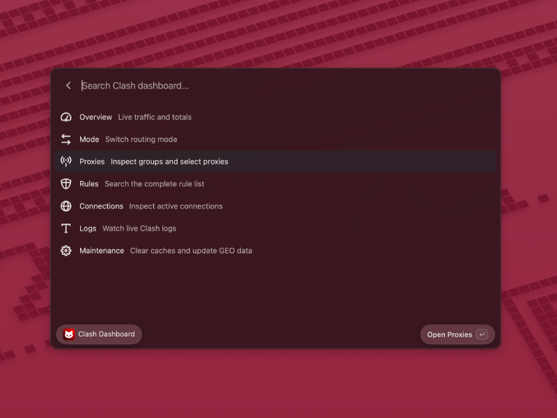
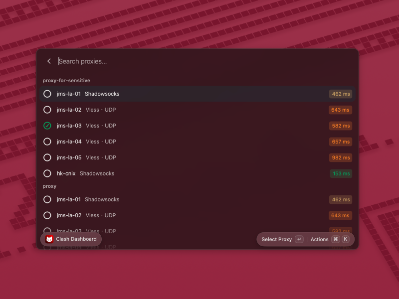

# Clash for Vicinae

A Vicinae extension for monitoring and controlling a Clash-compatible REST API.

Source repository: [xiaozhuai/vicinae-clash](https://github.com/xiaozhuai/vicinae-clash)

## Screenshots

### Dashboard

### Proxies

## Features

- Traffic and connection overview
- Proxy mode switching
- Proxy group inspection, selector switching, and latency testing
- Searchable rules with hit statistics and temporary enable/disable controls
- Live connections with connection management
- Live Clash logs
- DNS and FakeIP cache maintenance and GEO database updates
- Multiple backend profiles with token authentication

Open **Clash Backends** and add your Clash controller URL (for example, `http://127.0.0.1:9090`) and secret.
Then open **Clash Dashboard** to monitor and control that backend.
